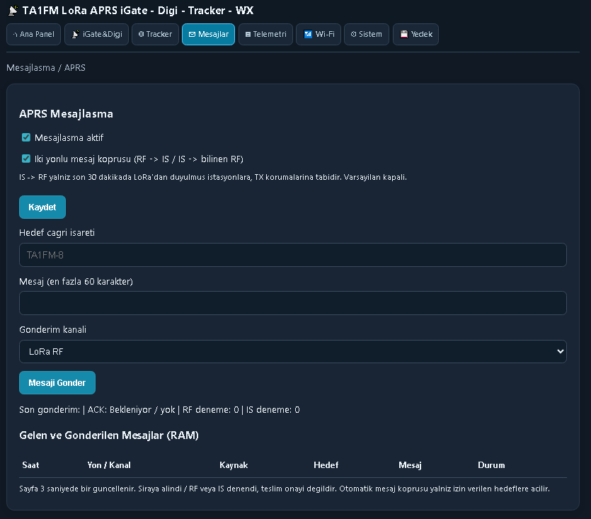

# TA1FM LoRa APRS iGate · Digipeater · Tracker

**TA1FM** amatör telsiz APRS uygulaması, farklı ESP32 kartlarında LoRa APRS iGate, RF Digipeater, GPS Tracker ve **LoRa modülü olmayan kartlarda Wi-Fi üzerinden APRS-IS Tracker** işlevlerini destekleyen bir yazılım ailesidir. Proje, Heltec Wireless Stick Lite V3 üzerinde başlamış, LILYGO T-Beam V1.2 SX127X ve ESP32 DIY NoLoRa kartlarına genişletilmiştir.

[🚀 **Web Flasher — USB ile firmware yükle**](https://ta1fm.github.io/TA1FM-LoRa-APRS-iGate-Digipeater/) · [📦 Firmware dosyaları](https://github.com/TA1FM/TA1FM-LoRa-APRS-iGate-Digipeater) · [🏷️ Releases](https://github.com/TA1FM/TA1FM-LoRa-APRS-iGate-Digipeater/releases)

> **Güncelleme — 25 Kasım 2026:** Aşağıdaki üç kartın belirtilen firmware sürümleri kararlı olarak doğrulanmıştır. Bu doğrulama **yalnızca test edilen kart ve donanım yapılandırmaları** içindir; aynı işlemciyi kullanan her kartın otomatik desteklendiği anlamına gelmez.

**Heltec güncellemesi (25 Kasım 2026):** 

## Desteklenen kartlar ve son çalışan sürümler

| Kart | Donanım | Doğrulanan sürüm | Firmware klasörü |
|---|---|---|---|
| **Heltec Wireless Stick Lite V3** | ESP32-S3 + SX1262 | **V2.1.0 — Web Flasher ve yedek geri yükleme testleri başarılı** | [heltec/WSL_V3/V2.1.0](heltec/WSL_V3/V2.1.0/) |
| **LILYGO T-Beam V1.2 SX127X** | ESP32 + SX127X (test cihazı SX1278), AXP2101 | **DEV9.4 — STABLE** | [lilygo/TBeam_V1.2_SX127X](lilygo/TBeam_V1.2_SX127X/) |
| **ESP32 DIY / NoLoRa** | ESP32 WROOM DevKit 30 pin, **LoRa yok** | **DEV8.3 — STABLE** | [esp32diy/Esp32_NoLora](esp32diy/Esp32_NoLora/) |

**Önemli:** Her kartın **kendine ait firmware dosyasını** seçin. Heltec'in ESP32-S3 firmware'i klasik ESP32 kartlara; T-Beam'in SX127X firmware'i SX126x T-Beam kartlara yüklenmemelidir.

# TA1FM LoRa APRS iGate & Digi V2.1.0

## 🚀 Yeni Özellikler

- **GPS Tracker:** GPS üzerinden konum takibi ve otomatik APRS konum gönderimi.
- **SmartBeaconing:** Hız ve yön değişimine göre akıllı konum gönderimi.
- **APRS Mesajlaşma:** APRS mesajı gönderme, alma ve ACK (onay) takibi.
- **Yenilenen Web Kontrol Paneli:** Daha düzenli menüler, gelişmiş ayarlar ve sistem durumu takibi.
- **Gelişmiş Digipeater:** Otomatik ve manuel çalışma seçenekleri.
- **APRS Telemetri:** Cihaz ve çalışma bilgilerini APRS üzerinden gönderme seçenekleri.
- **OLED Ekran Menüleri:** Cihaz bilgileri, GPS ve bağlantı durumlarını görüntüleme.
- **Fiziksel Buton Kontrolü:** OLED ekran ve Wi-Fi AP modunu cihaz üzerinden yönetme.
- **Ayar Yedekleme ve Geri Yükleme:** Tüm cihaz ayarlarını JSON dosyası olarak saklama ve geri yükleme.
- **Web OTA Güncelleme:** Firmware'i web panelinden güncelleme.

**Desteklenen donanım:** Heltec Wireless Stick Lite V3 (ESP32-S3 + SX1262)

**NoLoRa farkı:** ESP32 DIY NoLoRa sürümünde **LoRa RF TX/RX, RF iGate ve RF Digi yoktur**. GPS/Wi-Fi üzerinden APRS-IS Tracker, web panel ve desteklenen ekran özellikleri kullanılır.

**LoRa yapılandırması:** Türkiye'deki 433.775 MHz APRS kullanımı için projede SF12, BW125 kHz, CR 4/5 ayarları esas alınır. Doğru anten ve geçerli amatör telsiz yetkisi gereklidir. RF gücü kartın çıkış katına ve mevzuata uygun tutulmalıdır.

## Web Flasher ile USB kurulumu

[**TA1FM Web Flasher'a git**](https://ta1fm.github.io/TA1FM-LoRa-APRS-iGate-Digipeater/)

1. Chrome veya Edge ile Web Flasher'ı açın.
2. **Açılır menüden kartın tam modelini ve sürümünü** seçin.
3. Uygun USB veri kablosunu bağlayın. LoRa kullanan kartta doğru anten takılı olsun.
4. **INSTALL FIRMWARE** düğmesiyle COM portunu ve yüklemeyi onaylayın.
5. İlk açılışta Wi-Fi/APRS ayarlarını yapılandırın.

Web Flasher, seçilen kart için ilgili **`merged.bin`** görüntüsünü **0x0** ofsetiyle yükler. Mevcut ayarlar silinebilir; yüklemeden önce yedek alın. **`merged.bin` dosyasını OTA paneline vermeyin.** OTA için aynı kartın uygun bölümleme düzeniyle üretilmiş **uygulama `.bin`** dosyası kullanılır.

## İlk kurulum ve web paneli

Kaydedilmiş Wi-Fi yoksa kurulum AP'si oluşturulur:

| Alan | Varsayılan |
|---|---|
| Wi-Fi adı | `TA1FM-APRS-SETUP` |
| AP parolası | `1234567890` |
| Kurulum IP | `http://192.168.4.1` |
| Panel kullanıcısı | `admin` |
| Panel parolası | Bu üç kaynak sürümde `1234567890` (yükleyeceğiniz koddan kontrol edin) |

Şifreleri ilk kurulumdan sonra değiştirin, yönetim panelini doğrudan internete açmayın. Kendi amatör telsiz çağrı işaretinizi, SSID'nizi, APRS-IS giriş bilgilerini ve koordinatlarınızı kullanın.

## Kaynak dosyaları ve sürüm yönetimi

Çalışan kart sürümlerinin **`.ino`, uygulama `.bin`, birleşik `.merged.bin`, `.bootloader.bin` ve `.partitions.bin`** dosyaları yukarıdaki kart klasörlerindedir. Eski V1.5.7.1, V1.5.8 ve V2.0.0 BETA 1 (DEV7.2) sürümleri geri dönüş / geçmiş referansı olarak korunmaktadır.

**Derleme notu:** T-Beam DEV9.4 ve ESP32 DIY NoLoRa DEV8.3 için `board_config.h` ve `variants/boards/`, `variants/radios/` başlık dosyaları ilgili GitHub klasörlerine yüklenmiştir. Kaynak koddan derlerken **tüm ilgili klasörü** indirin; yalnız `.ino` dosyası yeterli değildir. `board_config.h` içinde doğru kart/radyo seçili olmalıdır. Hazır BIN dosyaları da mevcuttur. Tüm model çeşitlerinin otomatik algılanması henüz doğrulanmamıştır.

**Release bilgisi:** Kartlara özel STABLE sürüm notları [RELEASE_NOTES](RELEASE_NOTES/) klasöründedir. GitHub Release sayfasındaki yayımlanma durumu ayrıca kontrol edilmelidir; sürüm notu dosyasının bulunması tek başına yayımlanmış Release anlamına gelmez.

## Dokümantasyon

- [📘 Türkçe kurulum ve kullanım](KURULUM.md)
- [🛠️ Arduino IDE derleme](DERLEME.md)
- [🔌 Donanım bağlantıları](DONANIM_BAGLANTILARI.md)
- [🌍 English installation guide](INSTALLATION_EN.md)
- [📋 STABLE sürüm notları](RELEASE_NOTES/)

## Ekran görüntüleri

Proje: **TA1FM — Türkiye** · Lisans: **GPL-3.0** (depo içindeki LICENSE dosyası geçerlidir).

**73 de TA1FM!** 📡

## Web Flasher dosya duzeni

Web Flasher ana girisi `index.html` olarak kok dizinde kalir. Aktif kurulum JSON dosyalari [web-flasher/manifests](web-flasher/manifests/) klasorundedir; eski Heltec firmware kaynaklari ve BIN dosyalari [archive/heltec-legacy](archive/heltec-legacy/) altindadir. Sorunlu eski DEV8 manifesti [archive/legacy-manifests](archive/legacy-manifests/) klasorunde sadece arsiv amaciyla korunur; Web Flasher secim listesinde bulunmaz. V2.1.0, T-Beam ve DIY cihaz firmware dosyalari kendi klasorlerinde kalir.
